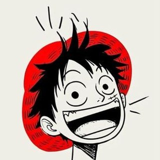
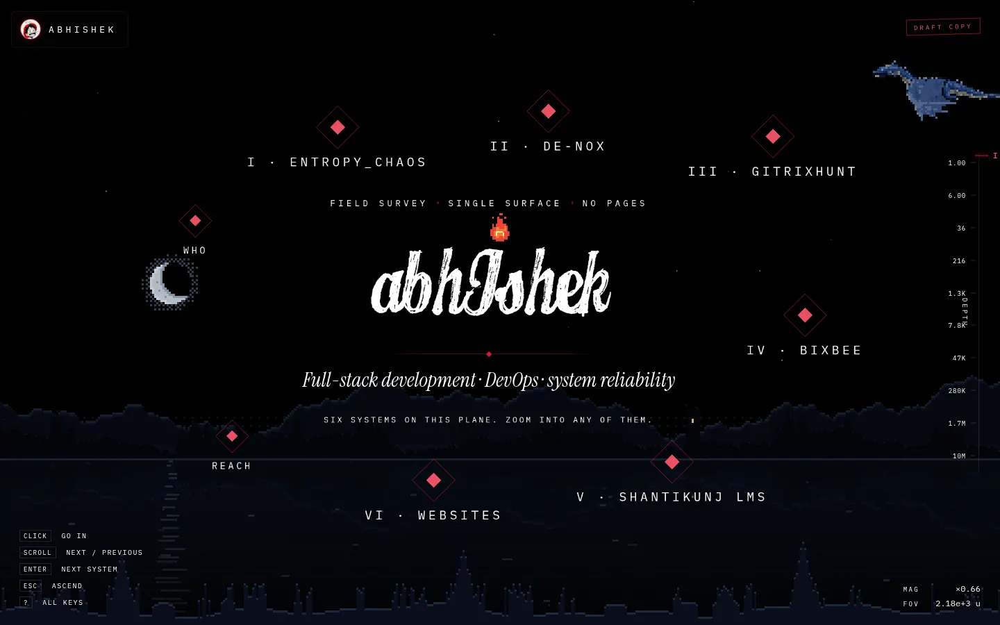
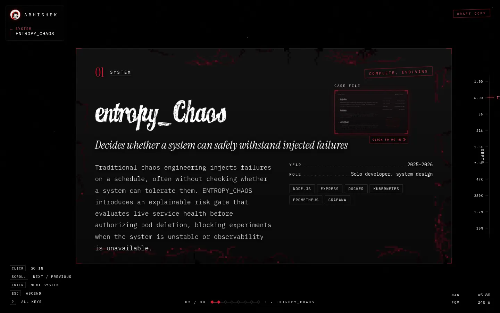
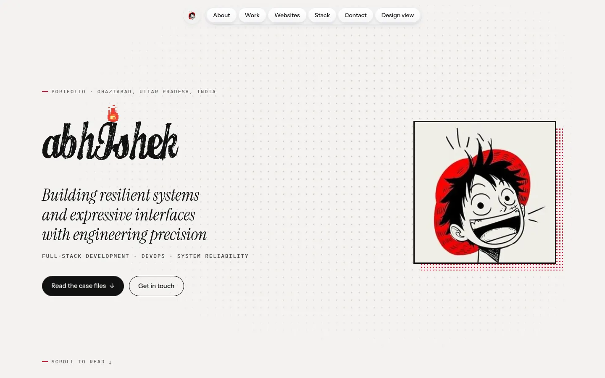
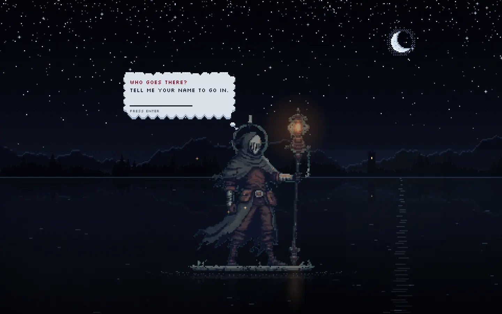
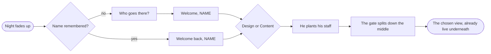
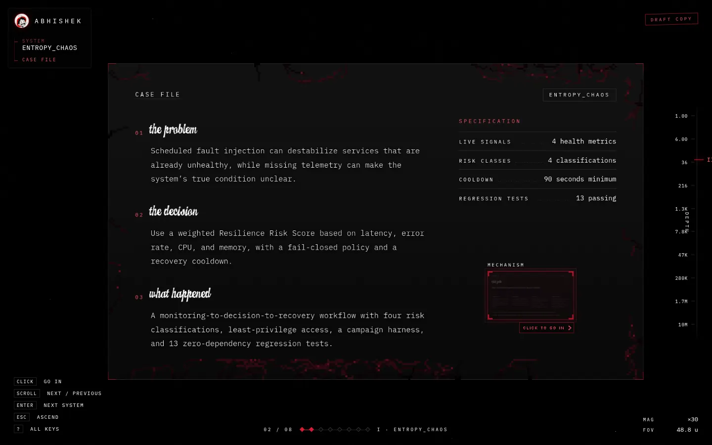
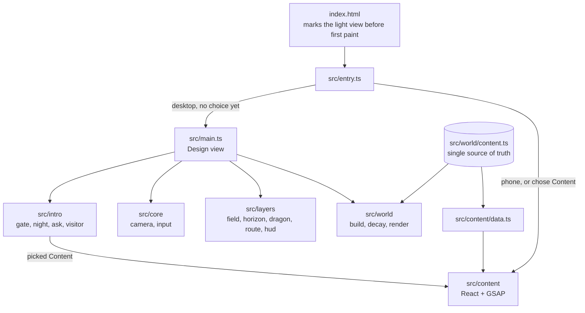

<div align="center">



# ZOOM

**A portfolio with no pages.**
One infinite plane where zoom level *is* information depth, and a second, quieter
reading of the same work for anyone who would rather scroll.

<p>
  
  
  
  
  
  
  
</p>

[Two experiences](#two-experiences) ·
[The gate](#the-gate) ·
[Design view](#design-view-the-zoomable-surface) ·
[Content view](#content-view-the-reading-copy) ·
[Animation](#animation-catalogue) ·
[Architecture](#architecture) ·
[Getting started](#getting-started)

<br />



</div>

---

## At a glance

| | |
|---|---|
| **What it is** | A personal portfolio for six pieces of work (five systems and a gallery of websites), told twice from one source of truth. |
| **Design view** | A night-sky surface you fly through. Each project descends five strata: name, plate, case file, mechanism, source. |
| **Content view** | A light, editorial one-page site with scroll-driven motion, built in React. |
| **Front door** | A pixel-art lantern-bearer on a lake who asks your name, remembers it, and asks how you want to see the work. |
| **Stack** | TypeScript (strict), Vite, hand-written WebGL and canvas for the Design view; React 19 and GSAP for the Content view. |
| **Art** | Every sprite is an Aseprite file in `art/`, rigged and baked by scripts in `tools/`. |
| **Size** | The Design view ships about 49 kB gzipped (JS and CSS). The Content view is a separate chunk that only its readers download. |

---

## Two experiences

<table>
  <tr>
    <td width="50%"></td>
    <td width="50%"></td>
  </tr>
  <tr>
    <td><b>Design</b>: the zoomable night surface. Fly, pinch and dive through the work.</td>
    <td><b>Content</b>: the same portfolio as an inked page in daylight, read top to bottom.</td>
  </tr>
</table>

Both views read the same tree, `src/world/content.ts`. The Content view reshapes it through
`src/content/data.ts`, so the two can never disagree, and changing the copy never means touching layout.

| Routing rule | Where |
|---|---|
| The gate asks which view to open, once per session. | `src/experience.ts` |
| `?view=design` and `?view=content` link straight to either. | `src/experience.ts` |
| Phones and coarse pointers always get Content: the surface has no phone layout. | `src/entry.ts` |
| Each view is its own dynamic import, so neither one's code reaches the other's readers. | `src/entry.ts` |
| The light view is marked before first paint, so there is no dark-to-light flash. | `index.html` |

---

## The gate



A lantern-bearer stands on a slab floating on a lake at night **while the site loads**. There is no
loading bar: he is the loading state. When the world behind him is ready, he asks your name in a pixel
thought-cloud, then asks how you would like to see the work.



- **Remembers you.** The name is kept in `localStorage` until the visitor clears site data
  (`src/intro/visitor.ts`). Returning visitors skip straight to the choice.
- **Real DOM over pixel art.** The cloud is drawn on the intro's cell grid with a scalloped, shaded
  edge, but the words and the field are real elements, so typing, autofill, screen readers and on-screen
  keyboards all work (`src/intro/ask.ts`).
- **Two resolutions on purpose.** The figure and the night are blitted 1:1 into a low-resolution
  canvas whose cells are one sprite pixel. The light around him (glow, flash, seam, mist) is smooth, on
  a full-resolution overlay.
- **Plays once per session.** Any key or click skips ahead. Under `prefers-reduced-motion`, or on a
  repeat visit in the same session, the same choice appears on a still card instead of the ceremony.

---

## Design view: the zoomable surface

<table>
  <tr>
    <td width="50%"></td>
    <td width="50%"></td>
  </tr>
</table>

The whole site is one plane. Far out you see the six systems in a ring around the name; zoom into one
and it unfolds into deeper strata, each one `ZOOM_STEP` (6x) smaller than its parent:

```
root          I    the surface: the name, the line, the ring of systems
└ project     II   the plate: name, one line, stack, status
  └ study     III  the case file: problem, decision, outcome, numbers
    └ mechanism IV how one part actually works, as staged steps
      └ source  V  the code itself, highlighted
```

**Controls**

| Input | Does |
|---|---|
| Click a panel or marker | Fly into it; click the panel you are on to go one stratum deeper |
| Scroll / swipe | Along the route, one page per gesture: surface, who, 1 to 6, reach |
| Pinch | Descend or ascend one stratum, settling onto a fitted frame |
| `Enter` / `Shift+Enter`, `←` / `→` | Next / previous on the tour |
| `↓` `Space` `+` | Descend one stratum |
| `↑` `Esc` `-` | Ascend one stratum |
| `1` to `6` | Jump to a system |
| `0` | Return to the surface |
| `?` | All keys |

The view always finishes on a fitted frame. Every gesture resolves to a panel and the camera settles
onto it, fitted to the part of the screen the HUD leaves free. Each depth writes itself to the URL hash,
so any stratum is linkable and the back button works.

---

## Content view: the reading copy

A light, editorial page in the palette of the avatar's ink drawing: paper, ink and the one red.
It keeps the surface's display face and the same pixel fire on the I, so both views open on one
signature.

| Section | What happens there |
|---|---|
| **Hero** | The name is drawn up out of its baseline; the italic line rises word by word from behind masks; the fire catches once the I is drawn. The entrance waits for its own two faces (capped at 1.2 s), so it never animates in the fallback font. A dot-grid screentone answers the pointer. |
| **About** | The lead statement sharpens word by word as it scrolls into view; the greeting uses the name given at the gate. |
| **Work** | An index, then one case file per project: lede, stack chips, screenshot panels with parallax, problem / decision / outcome, count-up metrics, a mechanism rail that fills with the scroll, and a source excerpt printed in reverse. |
| **Websites** | Every live site as a screenshot that sits in grey until the pointer comes near. |
| **Stack** | Two counter-running marquees of every tool, then the same tools grouped by system layer with the projects that use each. |
| **Contact** | Magnetic primary action, channel rows with a sweeping hover fill. |
| **Footer** | The page ends in the surface's night, with a door back to the Design view. |

---

## Animation catalogue

Every moving thing on the site, what it is built with, and where to find it.

### Technical motion

| Effect | Technique | File |
|---|---|---|
| Camera flight between pages | Pan-and-zoom along the van Wijk and Nuij curve (the one d3's `interpolateZoom` uses), in log-zoom space | `src/core/camera.ts` |
| Scroll and wheel travel | A goal chased by a critically damped spring, so notched wheels glide and a change of mind keeps its momentum | `src/main.ts` |
| Level of detail | Each node fades through a visibility band set as a fraction of the viewport diagonal; anything outside it is `display: none` | `src/world/build.ts` |
| Infinite star field | One fullscreen WebGL pass, three octaves of stars in world space, double-precision phase computed in JS | `src/layers/field.ts` |
| Arrival cascade | A page's contents rise out of a soft blur 55 ms apart once the camera lands | `src/world/build.ts` |
| Motion blur | At most 1.4 px on the world while the camera is really moving | `src/main.ts` |
| Route bar | Ticks and a fill driven by the spring's live position every frame | `src/layers/route.ts` |
| Smooth scroll and parallax | GSAP ScrollSmoother with `data-speed` layers and `data-parallax` drift | `src/content/App.tsx` |
| Scroll reveals | `ScrollTrigger.batch`, with already-passed elements shown at once after a long jump | `src/content/App.tsx` |
| Hero entrance | One GSAP timeline gated on font loading, with masked word rises from GSAP SplitText | `src/content/sections/Hero.tsx` |
| Mechanism rail | A scrubbed CSS custom property (`--fill`) that runs across on wide screens and down on narrow ones | `src/content/sections/ProjectCard.tsx` |
| Count-up metrics | Figures parsed from the copy and tweened once on entry, settling back to the written text | `src/content/sections/ProjectCard.tsx` |

### Design motion

| Effect | Technique | File |
|---|---|---|
| The gate | Sprite frames on a cell grid, a smooth light overlay, the gate halves parting and dissolving onto the world | `src/intro/gate.ts` |
| The night | Dithered sky, moon, ridges and a mirrored lake, composed once per layout; only stars and shimmer redraw | `src/intro/night.ts` |
| The horizon | The intro's night carried into the surface, sinking and fading within half a stratum of descent | `src/layers/horizon.ts` |
| The dragon | Four baked flight sets (flap, climb, glide, dive) picked to fit each pass; it banks, dives and narrows edge-on in turns | `src/layers/dragon.ts` |
| Fire on the I | A four-frame 11x17 sprite at its native 10 fps, anchored to the glyph's ink by measurement | `src/fx/flame.ts` |
| Plate decay | Seeded pixel-art veins and cracks along each plate's border; missing pixels cut real holes through a mask | `src/world/decay.ts` |
| Chroma reveal | Grey screenshots with a soft, lagging circle of colour following the pointer | `src/fx/chroma.ts`, `src/content/bits/ChromaGrid.tsx` |
| Dot-grid screentone | Canvas dots that swell and glow near the pointer and ripple from a click | `src/content/bits/DotGrid.tsx` |
| Pill navigation | A glass nav with a gliding hover pill and an active dot | `src/content/bits/PillNav.tsx` |
| Magnetic buttons, spotlight cards, marquees | Pointer-following transforms, a radial light under the pointer, seamless looping rows | `src/content/bits/` |

All of it respects `prefers-reduced-motion`: flights become crossfades, the gate becomes a still card,
scroll effects are not set up at all, and anything that was hidden for an entrance is simply shown.

---

## Architecture



<details>
<summary><b>Project structure</b></summary>

```
.
├── art/                 Aseprite sources: wanderer, night, dragon, samurai
├── tools/               Rigs and build scripts that bake the sprites
│   ├── dragon/          skeleton rig + bake (Node)
│   ├── night/           ridges and moon painter (Aseprite Lua)
│   ├── samurai/         IK rig + Aseprite assembly
│   └── wanderer/        animation export (Aseprite Lua)
├── public/              fonts, favicons, the fire sprite, site screenshots
├── docs/screens/        the screenshots in this README
└── src/
    ├── entry.ts         picks a view and imports only that one
    ├── experience.ts    the Design / Content choice and its routing
    ├── main.ts          the Design view: wiring, route, gestures to camera
    ├── core/            camera (cx, cy, log z), input intent
    ├── layers/          WebGL star field, horizon, dragon, route bar, HUD
    ├── world/           the content tree, plate builder, decay, highlighter
    ├── intro/           the gate, its night, the name cloud, remembered name
    ├── fx/              the fire on the I, chroma reveal
    ├── styles/          tokens and the Design view's CSS
    └── content/         the Content view
        ├── sections/    Hero, About, Work, ProjectCard, Showcase, Stack, Contact, Footer
        ├── bits/        interaction components from React Bits
        ├── data.ts      reshapes the world tree into page records
        └── motion.ts    GSAP registration and section navigation
```

</details>

### Engineering patterns

- **Single source of truth.** One typed tree drives both views; the Content view only reshapes it.
- **State is three numbers.** The Design view's whole state is `(cx, cy, z)`, where `z` is the natural
  log of the zoom scale. A zoom from x1 to x10,000 is a straight line in `z`, so easing and momentum
  behave the same at every depth.
- **Input reports intent, not positions.** Gestures say "go on", "go deeper" or "go back"; `main.ts`
  decides the camera, so every gesture ends on a properly fitted frame.
- **Code splitting by experience.** Each view is a dynamic import; the chosen view starts loading the
  moment it is picked, behind the gate's greeting.
- **Explicit animation end states.** Tweens are written as `fromTo` with known end values, so nothing
  inherits a half-finished CSS transition.
- **Fail visible.** Motion only ever starts from a hidden state it sets itself, so a script failure
  leaves a readable page.
- **Seeded randomness.** Decay, sparks and scatter are seeded, so every visit draws the same thing.
- **Strict TypeScript.** `strict`, `noUncheckedIndexedAccess`, `verbatimModuleSyntax`, no unused locals.

<details>
<summary><b>Deep dive: seven orders of magnitude without the stars swimming</b></summary>

At x4e7 zoom the interesting world coordinates are around 1e-7, and float32 cannot hold "camera
position" and "cell size" at that ratio without the field visibly swimming. So the camera is never sent
to the GPU. JavaScript computes each octave's *phase*, `fract(camera / cell)`, always in `[0, 1)`, and
its wrapped *cell index*, both in double precision. The shader only ever sees small numbers, and a star
keeps its identity whatever zoom it is viewed from.

The stars live in world space across three octaves, each a factor of 6 finer than the one above, so
descending a stratum does not magnify the same field: it reveals a finer one that was always there.

</details>

<details>
<summary><b>Deep dive: level of detail as a visibility band</b></summary>

Every node carries a world scale `s`; its on-screen size is `s x cameraScale`, and it fades in and out of
a band expressed as fractions of the viewport diagonal (not pixels, so the world is not mis-scaled on a
5K display). The band is about 8.5x wide at full opacity, wider than the 6x between strata, so at least
one stratum is always fully legible and every transition is a crossfade. Nodes outside the band are
`display: none` and cost nothing.

</details>

<details>
<summary><b>Deep dive: welding a sprite to a letter</b></summary>

The title is one shaped text run in a script face, so splitting it into per-letter spans would break the
joins. Instead a `Range` finds the I's box, and an offscreen rasterisation of the same string finds the
ink: the vertical comes from the top of that glyph, the horizontal from the ink centroid. The probe
reproduces the title's negative tracking, and everything is divided by the camera scale, which keeps the
flame on the letter at every zoom level.

</details>

---

## Design system

**Palette.** Three colours, strictly rationed: black ground, white content, red as the only signal.
On the surface the stars, vignette and grain never touch red, so every red mark is content. Two reds
exist for contrast: `#d71935` for marks and rules, a lighter red for anything set at label size. The
Content view inverts the ground to paper (`#f3f2ef`) and ink (`#121212`) with the same red.

**Typography.**

| Face | Job |
|---|---|
| **Candy Inc** | The name and headings without digits or punctuation (self-hosted, preloaded) |
| **Instrument Serif** | Italic emphasis lines, headings in the Content view, the `01` to `06` indices |
| **IBM Plex Mono** | Labels, code, the HUD, everything technical |
| **Instrument Sans** | Body copy in the Content view |

Candy Inc is a trial cut: its digits render as watermarked glyphs and most punctuation is missing, so it
is only applied where neither appears. Its license is freeware, non-commercial, personal use only (see
`public/fonts/CandyInc-LICENSE.txt`). If the site ever promotes paid work, buy the commercial license or
point `--display` at the serif fallback; that token is the only place the face is named.

**Pixel art.** Everything drawn in pixels shares one rule: one canvas cell per art pixel, scaled
nearest-neighbour, so sprites stay hard-edged at any size. Light is the exception and is drawn smooth.

---

## Accessibility

- Every marker is a real `<button>` with an `aria-label`; every channel is a real link.
- Full keyboard navigation in both views, a skip link and visible focus rings in the Content view.
- Decorative canvases are `aria-hidden`; the gate's question is a labelled dialog with a real input.
- `prefers-reduced-motion` is honoured everywhere (see the [animation catalogue](#animation-catalogue)).
- No WebGL: the canvas removes itself and a CSS ground tone carries the look.
- No JavaScript: a `<noscript>` card with the short version and an email address.

---

## Getting started

Requires Node `>= 22.12`.

```bash
npm install
npm run dev          # http://localhost:5173
npm run build        # type-check, then build to dist/
npm run preview      # serve the build locally
npm run typecheck
```

Open `/?view=content` or `/?view=design` to go straight to either view.

### Editing the content

Everything written on the site lives in `src/world/content.ts`. You never touch layout, CSS or
geometry to change copy. See **[CONTENT.md](CONTENT.md)** for the shape of the tree and how to place a
new project.

### Rebuilding the art

The sprites are generated, not hand-placed. Each command needs Aseprite on `PATH` or in `ASEPRITE`.

| Command | Builds |
|---|---|
| `npm run art:wanderer` | The lantern-bearer's sheet and frame data from `art/wanderer.aseprite` |
| `npm run art:night` | The ridges and moon from the night painter |
| `npm run art:dragon` | The dragon's four flight sets from its skeleton rig |
| `npm run art:samurai` | The samurai from its IK rig (an earlier intro, kept in `src/intro/katana.ts` but not wired in) |

### Deployment

Configured for Vercel (`vercel.json`): `npm ci`, `npm run build`, output `dist/`. Hashed assets are
cached for a year as immutable; every response sends `X-Content-Type-Options`, `Referrer-Policy` and
`X-Frame-Options`.

---

## Credits

- Interaction components in `src/content/bits/` are adapted from [React Bits](https://reactbits.dev).
- Motion in the Content view uses [GSAP](https://gsap.com), including ScrollTrigger, ScrollSmoother and SplitText.
- Display face: Candy Inc (trial, personal use; see the license file). Text faces: Instrument Serif,
  Instrument Sans and IBM Plex Mono from Google Fonts.

<div align="center">
<br />
<sub>Built by <a href="https://github.com/soul-abhi">soul-abhi</a>.</sub>
</div>
